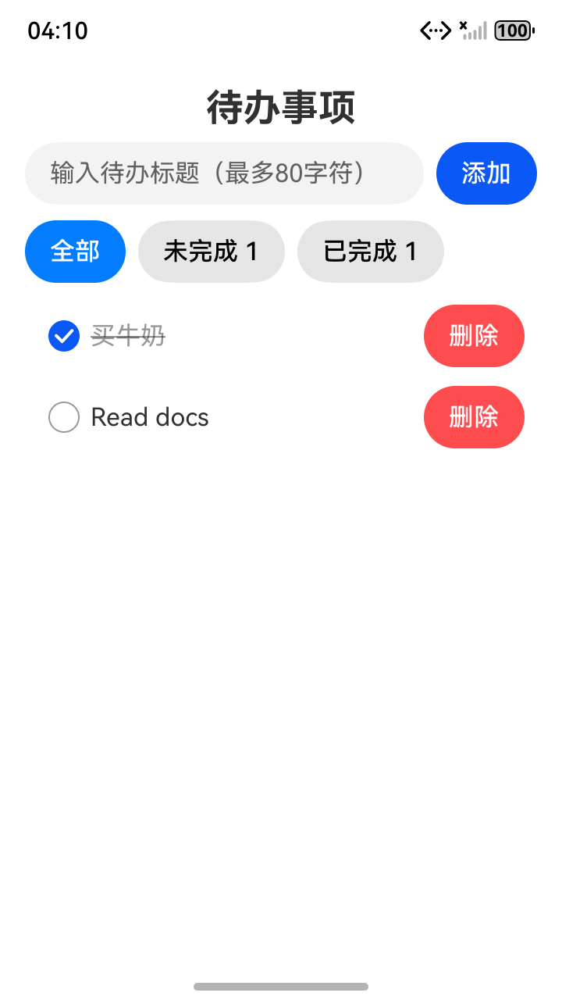
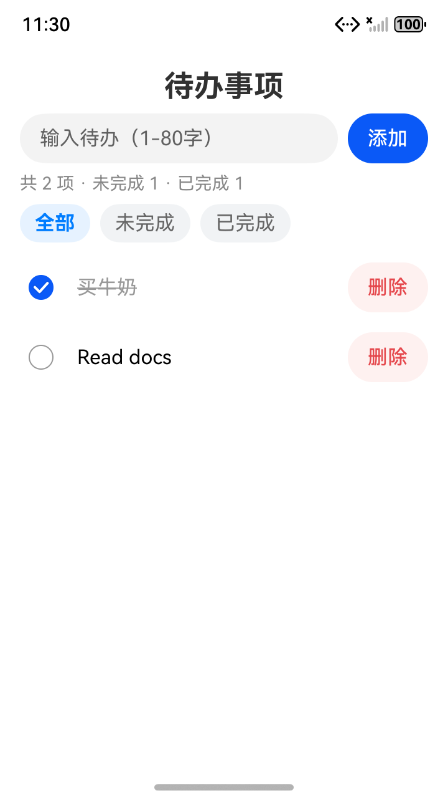

# 鸿蒙 TodoList 真实实验结果

## 2026-10-18：提交前审查

提交前审查修复了配置助手将开放插件策略变成单插件白名单的问题，并补齐宿主路由的包内目录固定及普通/子会话日志工作目录回退。配置回归使用真实 OpenClaw 同时加载 VeriKit 和另一个已启用插件，验证缺省、空白名单下原插件不会被关闭。

修复后的回归为 **15/15**，真实宿主对照仍为 **16/16**；三宿主重新构建并检查独立打包。准备提交的最新 GLM 示例在新的隔离目录重新执行业务 **11/11** 和实际 SDK 编译，均通过。审查与构建核对见[提交前记录](evidence/20261018/precommit-review.json)。

本次审查没有新增 GLM 调用或设备重跑。下方的 **18/18** 模型流程与 **11/11** 模拟器结果属于各自冻结的真实实验版，原记录及哈希没有重写；修复后路由结果和系统指导已与该实验输入逐项比较，保持一致。提交前的新运行文件哈希单独记录，不将历史源码哈希冒充为当前版本。

## 2026-10-18：首次参考读取修复及完整续跑

剩余的“首次漏读 ArkTS 参考”已在全新隔离会话中修复。真实 OpenClaw 2026.7.1-2 调用 GLM glm-5.3-flash，在首次代码工具调用前完整读回所选 arkdata、arkts 的入口说明和任务参考。此前 2026-10-17 的失败记录及本次中间试验均保留。

### 本次结果

| 层级 | 结果 | 证据 |
| --- | --- | --- |
| 三宿主回归 | 14/14，无跳过 | [原始日志](evidence/20261018/regression.log) |
| 真实 OpenClaw SDK 对照 | 16/16，无模型替代 | [对照结果](evidence/20261018/native-controls.json) |
| 真实 GLM 完整插件流程 | 18/18 | [流程记录](evidence/20261018/plugin-acceptance.json) |
| 首次代码调用前的文档内容核对 | 两个 Kit 的入口及各一篇任务参考全文通过 | [首次冻结结果](evidence/20261018/read-before-code-proof-initial.json)、[快照复核](evidence/20261018/read-before-code-proof.json) |
| 本次 GLM 应用纯业务 | 11/11，执行生成的实际模型 | [业务结果](evidence/20261018/business-acceptance.json) |
| 本次应用真实 SDK 编译 | 首次失败，经模型修复后成功 | [首次](evidence/20261018/build-result-initial.json)、[最终](evidence/20261018/build-result.json) |
| 本次应用专用模拟器 | 11/11，两次进程重启恢复 | [设备结果](evidence/20261018/device-acceptance.json) |
| 三宿主产物 | 已构建，独立打包、无嵌套宿主产物 | [打包核对](evidence/20261018/packaging-summary.json) |

首次开发消息、Kit 选择和原来的 18 项流程检查没有加入指定 ArkTS 文件名，也没有放宽原检查。另加内容审计和人工相关性核对，排除“只看路径”“只读片段”和“读取无关 FAQ”。后续应用修复没有追记为首次文档通过。

### 插件修改

- 按 Kit 分别列出 SKILL.md 与参考文档两项检查，语言及辅助 Kit 同样适用；成功读回后才调用代码工具。
- read_plan 提供绝对路径和连续 skill_reads 范围，每段至多 100 行、通常不超过 32 KiB，处理 ArkTS 入口超过宿主单次 50 KiB 上限的情况。
- 至少一篇所选任务参考须读至 EOF；不以开头预览代替全文，也不遍历全部无关文档。
- 根据 local-persistence 配方的异步处理职责，提供 ArkTS Promise/async-await 参考导航。长消息将该配方挤出前三个匹配时，明确出现的配方标识仍能提供导航；它不代表用户已批准任何 Kit。原始 top、compositions、deep_references 排名保持不变。
- OpenClaw 将清单同时放入原生系统指导和提示上下文，手动工具返回同样的导航信息；共享实现也进入另外两个宿主产物。编辑监测仍只记日志。

### 首次读取的直接证据

以下为香港时间 2026-10-18（UTC+08），来自实际原生 transcript：

| 事件 | 时间 | 返回内容 |
| --- | --- | --- |
| ArkData《通过用户首选项实现数据持久化》成功返回 | 04:00:06.627 | 13,912 字节，全文哈希与源文件相同 |
| ArkTS《异步并发 (Promise和async_await)》成功返回 | 04:00:06.627 | 7,236 字节，全文哈希与源文件相同 |
| 最早代码工具调用（含失败尝试） | 04:00:08.754 | apply_patch；两篇参考此前已读回 |

两个 SKILL.md 也在上述代码调用前完整覆盖。审计关联 toolCallId、实际返回、时间顺序、分段范围和源文件哈希；observer 的长文本会被宿主缩短，因此内容证据直接取原生 transcript。Preferences 文档对应实际存储读写与 flush，异步并发文档对应实际 Promise 队列及 await 调用。

首次审计已在修复前保存为独立原生快照。后续宿主整理会话并更换 transcript 路径，使仅查“当前会话文件”的复核程序找不到最初代码调用；审计工具现优先读取该初始快照。首次冻结脚本、首次结果和新脚本哈希同时保存，内容匹配与先后顺序判据没有变化。
实际测试运行文件、首次冻结审计、源码归档与 HAP 的一致性见[哈希记录](evidence/20261018/source-hashes.json)。

### 应用验收与保留的错误

[本次 GLM 应用源码](../../examples/harmonyos-todolist-glm-20261018/README.md)独立归档，未使用本地参考实现替换。初次业务 11/11，实际编译发现无类型对象字面量和 unknown 两处错误，源码审阅还发现遗漏原需求的行 id，以及读取失败后的变更保护、数量刷新依赖问题。反馈交给同一模型处理。

三轮修复中，前两轮工具修改部分生效，但又提交了新旧文本相同的 edit，原生工具返回 terminate:true，宿主最终回复为 error。这两轮保留为错误轮：首次修复后仍有 Promise 回调返回类型错误；第二次后编译通过，但行 id 仍遗漏。第三轮实际补齐行 id、read 确认并正常完成，最终复编译与设备验收通过。[运行摘要](evidence/20261018/live-run-summary.json)包含这些轮次及错误，不将它们视作正常完成。

设备测试在本次新建的 API 21 模拟器中安装实际 unsigned HAP，逐项完成空列表、空白拒绝、中文和英文含空格新增、完成、两个筛选、重启恢复、恢复未完成、删除、再次重启恢复。原生组件树还确认数量从 0/0、2/0、1/1、2/0 变为 1/0，见[数量核对](evidence/20261018/counts-layout-review.json)。仍有 getContext 弃用等编译警告，实体设备及发布签名未测试。

### 本次中间试验

| 隔离目录后缀 | 观察 | 最终处理 |
| --- | --- | --- |
| 20261018-todolist-read-plan | 笼统续读要求导致过量阅读，开发轮 360 秒超时 | 仅 4 项完成、14 项未运行，[记录](evidence/20261018/workflow-overreading.json) |
| 20261018-todolist-read-ranges | 两个入口完整，但 ArkTS 参考只读前 60 行 | 原路径检查 18/18，新增全文审计失败，[内容证据](evidence/20261018/read-proof-partial-reference.json) |
| 20261018-todolist-reference-eof | 全文读回，但选中与任务无关的 XML/定时器 FAQ | 字节覆盖通过，人工相关性不接受，[内容证据](evidence/20261018/read-proof-unrelated-reference.json) |
| 20261018-todolist-feature-guides | 只按前三个配方找导航，长消息中的明确配方未触发 | 回归 13/14，保留[失败日志](evidence/20261018/regression-navigation-initial.log)；修复后回归 14/14 |
| 20261018-todolist-final | 最终版本，首次读取完整且相关 | 本次最终结果，独立完整流程与应用验收 |

上述路径均在 experiments/runs/ 下，原始模型输入、工具调用、返回、失败源码、反馈、编译日志、组件树和 HAP 保留。对 2026-10-17 原失败会话的[反向核对](evidence/20261018/read-proof-old-failure.json)仍判为未读 ArkTS 参考。

目的地和数据范围沿用用户明确授权；密钥只通过隐藏输入和子进程环境使用，不进入报告或模型提示。日常 OpenClaw 配置哈希未变，runtime-corrector-toy 未修改。实验 Gateway 和专用模拟器已关闭，见[隔离与清理记录](evidence/20261018/cleanup.json)。一次真实场景通过仍不构成所有模型、任务都遵从提示的保证。

## 2026-10-17：此前完整实验（保留原结论）

2026 年 10 月 17 日完成续跑。用户提供的主凭据验证成功，使用真实 OpenClaw 2026.7.1-2 与 GLM glm-5.3-flash 生成应用，经一次验收反馈修复后，通过实际鸿蒙编译和全部 11 项设备验收。模型流程检查为 17/18，首次开发漏读 ArkTS 参考的失败保留，不能宣称全部模型行为通过。

## 最终结果

| 层级 | 结果 | 证据 |
| --- | --- | --- |
| 三宿主回归 | 12/12 通过，无跳过 | [regression-summary.json](evidence/20261017/regression-summary.json) |
| 真实宿主 SDK 对照 | 16/16 通过，无模型调用 | [native-controls-after.json](evidence/20261017/native-controls-after.json) |
| 真实 GLM 工作流 | 17/18 通过，首次漏读参考 1 项失败 | [plugin-acceptance-live.json](evidence/20261017/plugin-acceptance-live.json) |
| 模型应用纯业务 | 11/11 通过，执行实际 ArkTS 模型，无替代实现 | [business-acceptance-glm.json](evidence/20261017/business-acceptance-glm.json) |
| 模型应用鸿蒙编译 | 初次失败，模型修复一次后成功 | [首次](evidence/20261017/build-result-glm-initial.json)、[复编译](evidence/20261017/build-result-glm.json) |
| 模型应用设备验收 | 11/11 通过，包括两次进程重启恢复 | [device-acceptance-glm.json](evidence/20261017/device-acceptance-glm.json) |
| 本地参考应用 | 业务 11/11、编译、设备 11/11 通过 | [业务](evidence/20261017/business-acceptance.json)、[编译](evidence/20261017/build-result.json)、[设备](evidence/20261017/device-acceptance.json) |

真实宿主对照调用本机加载器、钩子、工具权限、会话 SDK 和原生写入工具。模型流程则记录实际模型输入、工具调用及响应；两类结果分别统计。完整测试设计见[实验方案](harmonyos-todolist-plan.md)，复现步骤见[运行说明](../../scripts/experiments/README.md)。

## 真实模型与应用

模型首轮展示 Kit 和配方选项，等待实验用户明确选择，没有写文件。选择 arkdata、arkts 后，模型读取两个 SKILL.md 和 ArkData Preferences 参考，生成真实 ArkUI 页面、纯 TodoModel、Preferences 存储层。它未在首次写代码前读取 ArkTS 参考，因此该项仍为 FAIL。

首次业务验收 11/11；实际 SDK 编译发现 JSON.parse 结果隐式 any/unknown。外部验收反馈还指出组件保留字段命名和吞掉读取失败的问题。反馈交回同一模型后，模型补读此前漏掉的 ArkTS 参考，修复显式类型、字段名和读取失败处理。该轮沿用会话中已读的 ArkData 文档，没有把补读追记为首次通过。

修复后的业务检查仍为 11/11，API 21 实际编译成功，HAP 含 ArkTS 字节码。在专用模拟器安装启动后，逐项通过空列表、空白拒绝、中文新增、英文含空格新增、完成、两个筛选、进程重启恢复、恢复未完成、删除及第二次进程重启恢复。所有业务修改由真实模型工具实施，本地只执行独立验收与归档。

源码分开保存：
- [GLM 生成并修复的应用](../../examples/harmonyos-todolist-glm/README.md)：包名 com.verikit.experiment.todolist。
- [本地参考应用](../../examples/harmonyos-todolist/README.md)：包名 com.verikit.experiment.todolistreference。

两个应用的数据互不混用，参考实现的成绩不计入模型应用。编译仍有 getContext 弃用等警告；生成的是 unsigned HAP，已在模拟器实际安装，未调整签名校验。实体设备与发布签名未测试。

## 实验推动的插件修复

1. 普通常识问题仅凭归一化 BM25 或“城市名称”弱触发词误注入。自动注入现在要求配方、明确平台/Kit 名，或同时命中触发词与开发意图；手动工具保留原始排序。
2. 原监测漏掉宿主实际提供的 apply_patch。现在逐文件检查新增 SDK .ets 内容，支持移动路径，跳过删除和非 .ets 文件，仍只记日志、不阻止编辑。
3. 低推理档位下复现模型确认前写代码。选择流程现在同时进入原生 appendSystemContext，明确未确认时展示选项后停止，已有选择则继续。修复后真实会话首轮等待选择；宿主禁止提示注入时，普通提示和系统指导均被抑制。

16 项宿主对照涵盖注册、路由、无关问题、冲突、手动工具和参考路径、工具拒绝、真实会话日志、Kit 提及抑制日志、补丁日志、关闭日志、禁止提示注入、路由异常、手动错误、15 秒超时、故障恢复哈希和关闭插件。最新超时对照约 15,004 毫秒。故障仅替换实验副本 CLI，结束后恢复字节完全一致。

系统指导提高了本次选择流程的遵从性，但没有改成编辑权限检查。真实模型仍可漏读文档，17/18 的结果正体现这一限制。一次场景通过不代表所有模型或所有任务均会遵从。

## 环境、授权与隔离

- 宿主为本机 OpenClaw 2026.7.1-2、Node 26.0.0。鸿蒙为预装 DevEco Studio macOS SDK、HarmonyOS 6.0.1 API 21，构建缓存独立，无下载构建依赖。
- 模型目的地始终为用户批准的 https://open.bigmodel.cn/api/anthropic。仅发送合成 TodoList 需求、公开 VeriKit/HarmonyOS 文档、合成模板及本次生成代码。主凭据 HTTP 200 后未使用备用；密钥只存在隐藏输入、内存和子进程环境，不进入版本库、报告或模型提示，不修改日常凭据文件。
- 原配置未将该模型声明为支持推理。独立实验配置按[官方模型说明](https://huggingface.co/zai-org/GLM-5.3-Flash)声明强制推理能力，并通过原生 provider 包装接口显式使用 low 档位。provider_request 审计记录实际参数，不改写路由判断、模型回复或已安装宿主代码。
- 初始设备输入受输入法协议阻断。用户明确允许本次专用模拟器使用基本模式后，仅选择“同意基本模式”和普通 26 键布局，未选择全量模式，见[设置记录](evidence/20261017/keyboard-setup.json)。
- 模型无 Shell 工具，文件工具限于独立工作区。实验 observer 与配置在工作区外；没有复制既有模拟器或其他项目数据。设备应用验收只针对两个合成应用，输入法设置只在该专用实例完成。
- 日常 OpenClaw 配置哈希保持一致，runtime-corrector-toy 未修改，参考提交为 e136761395ef295b8218d6a3eddeb5cdb05eb610。MA 桌面和 Windows 宿主未实测。
- 所有实验 Gateway 已停止；专用模拟器同步数据并核对进程后关闭。实验数据保留用于复核。

## 历史失败与证据位置

失败轮次没有删除，也未混入最终有效轮次计分：
- 20261017-todolist：旧凭据 HTTP 401，模型行为未运行，[原始结果](evidence/20261017/plugin-acceptance.json)。
- 20261017-todolist-glm-retry：首轮真实连接成功，暴露排队无正文 final 回执的实验判定错误。
- 20261017-todolist-glm-verified：默认推理设置下开发轮达到 360 秒上限。
- 20261017-todolist-glm-low：宿主缺少推理能力声明，返回配置提示，未计作模型完成。
- 20261017-todolist-glm-final：旧提示在低档位下复现确认前写代码。
- 20261017-todolist-glm-system：最终系统提示版本的完整工作流与一次 SDK 修复，[运行摘要](evidence/20261017/live-run-summary.json)。

上述根目录均在 experiments/runs/ 下，不进入 Git。原始模型输入、工具顺序、修复反馈、首次失败代码、编译日志、组件树、设备命令和 HAP 都保留。设备准备阶段的协议阻断、布局设置及输入转义夹具失败也保留，最终验收使用修正后的测试程序，没有将准备失败算作应用缺陷或通过项。

可审阅快照位于本目录 evidence/20261017/；[源码与隔离校验](evidence/20261017/source-hashes.json)记录当前插件、实际测试源码和归档源码的一致性。三宿主产物可通过 npm run build:plugins 重建。
