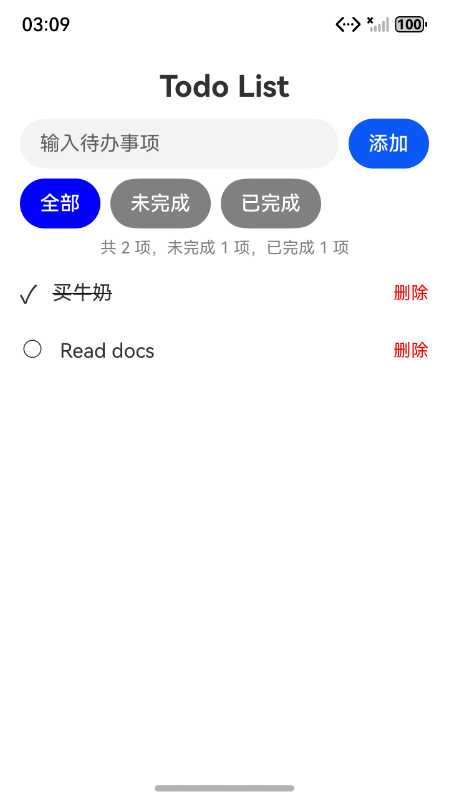

# VeriKit + Runtime Corrector 联合鸿蒙实验（2026-10-18）

已在独立 OpenClaw **2026.7.1-2** 中同时加载并启用两个插件，使用真实 **GLM-5.3-Flash** 从空工程开发 HarmonyOS API 21 TodoList。最终应用的纯业务 **11/11**、SDK 编译和专用模拟器 **12/12** 均通过，首次写码前的所选 Kit 全文读取审计通过。修复后的新一轮 RC 终审也已 **PASS**，见[机器摘要](evidence/20261018-joint/joint-summary.json)。

发现并修复了 VeriKit 对 RC 私有评审会话重复注入 Kit 选择指导的问题。RC 对受控 800 字符缺陷实际发出了纠偏，宿主读取反馈后将其恢复为 80；该次修复后的终审遇到网络故障，保留 **UNVERIFIED**。设备发现的界面刷新问题由独立验收反馈触发修复，不能归功于 RC 自动发现，也不能把历史失败改成通过。

## 环境、范围与设计

- VeriKit 基线提交 `c31c36a`，本次额外修改仅涉及 OpenClaw 评审会话过滤、回归与实验材料；当前运行源码的哈希在证据中冻结。
- RC 只读来源为 `/Volumes/PortableSSD/projects/runtime-corrector-toy` 的 `e136761395ef295b8218d6a3eddeb5cdb05eb610`。包版本 `1.9.1-openclaw.11-session-projects.9`，使用其原有构建器将包写入隔离实验目录；不修改其源码、宿主安装或日常 profile。
- 同时启用 `verikit`、`runtime-corrector`；另有只观察原生事件及设置已批准推理档位的实验 observer。未替换模型响应、注入模拟 reviewer 或代宿主修复业务源码。
- 工作模型与审阅模型均使用已授权的 `https://open.bigmodel.cn/api/anthropic`、`glm-5.3-flash`。主助手、需求提取、终审使用独立原生会话，但模型同源，不是异构模型评审。
- RC 项目显式启用需求提取与原生 Stop 纠偏，k=3、角色窗口 20 分钟、完整终审窗口 60 分钟；Skill 纠偏、逐产物语义评审与 implementationCorrection 关闭。这里不声称覆盖 RC 全部功能。
- 模型只获得隔离工作区的原生 read/write/edit 与获准插件工具，禁止 shell。SDK 构建、业务执行、设备操作均由独立验收程序执行。

预先保存了[实验计划](evidence/20261018-joint/joint-plan.json)。任务要求真实 Preferences、串行 flush、新增/完成/恢复/删除、三种筛选、数量统计、中文、稳定 id 与 trim 后 80 字符上限。先开发并记录自然问题，再注入一个应用边界缺陷，最后修复设备问题并独立复验。

受控检查点后来增加了一个无业务作用的源码注释写入，因为 RC 原生 Stop 由编辑等操作触发，纯读取轮不会安排终审。该调整及原因见[计划补充](evidence/20261018-joint/plan-amendment-1.json)。它没有改变 RC 或宿主实现，也没有放宽 80 字符标准。宿主模型在首轮也已自行指出 800 与需求冲突，因此该对照证明反馈、续作、修复链路，不证明该缺陷只能由 RC 发现或提高了自然缺陷检出率。

## 阶段结果

| 阶段 | 真实结果 | 结论边界 |
| --- | --- | --- |
| 原始 VeriKit 联合对照 | 两个插件加载；所选文档全文读取；业务 11/11；RC PASS；SDK 编译失败 | RC 语义 PASS 没有检出实际 ArkTS 编译错误 |
| VeriKit 会话过滤后，从新工程开发 | 所选文档全文读取；业务 11/11；SDK 编译通过；RC PASS | 首次设备检查仍发现界面问题 |
| 首次设备验收 | 4 PASS、1 FAIL、7 NOT_RUN | 点击完成后 ○ 没有刷新为 ✓；后续项目未运行 |
| 受控边界注入 | 实际常量 80→800，业务 11/11→10/11 | 只改可丢弃应用；需求不变 |
| RC 受控纠偏 | DEVIATION；反馈有 modelObservedAt；宿主真实 edit 800→80；业务恢复 11/11 | 复验遭遇模型网络错误，最终 UNVERIFIED；不将其算作完整 PASS 闭环 |
| 外部设备反馈修复 | 同一 GLM 补读 ArkUI 参考后修改页面；业务 11/11、SDK 编译通过，新一轮 RC 终审 PASS | UI 修复与错误路径审阅来自外部验收反馈 |
| 最终设备验收 | **12/12** | 含完成/恢复、统计、筛选、删除和两次实际进程重启恢复 |

[原始联合对照摘要](evidence/20261018-joint/original-control-summary.json)、[原始 SDK 失败日志](evidence/20261018-joint/original-control-build-failure.log)、[首次设备失败](evidence/20261018-joint/initial-device-acceptance.json)、[失败时的实际布局](evidence/20261018-joint/initial-toggle-failure-layout.json)均保留。

实际注入的常量位置与前后哈希见[受控缺陷](evidence/20261018-joint/controlled-fault.json)。[负例业务检查](evidence/20261018-joint/controlled-fault-business.json)、[纠偏后业务检查](evidence/20261018-joint/after-rc-business.json)、[原生回执与反馈观察](evidence/20261018-joint/rc-receipts-challenge-1.json)共同证明结果。原生观察记录中的实际 edit 在 `modelObservedAt` 之后，仅将常量 800 改回 80；没有第二条驱动指令或本地代改业务来完成这个修复。

## VeriKit 文档与共存修复

[原生全文读取审计](evidence/20261018-joint/read-before-code-proof.json)逐段比对返回内容、来源哈希及工具顺序。主助手在首次代码调用前完整读取：

- `arkdata/SKILL.md` 和《通过用户首选项实现数据持久化 (ArkTS)》。
- `arkts/SKILL.md` 和《异步并发 (Promise和async_await)》。

原始对照的 RC 内部会话也收到了与评审无关的 VeriKit Kit 选择与阅读指导。修复只按 RC 已有的原生私有会话键 `agent:<agent>:runtime-corrector:<session>` 排除自动路由与编辑监测；没有按提示文本猜测身份。RC 在原业务会话中的续作仍保留指导，手动工具仍由宿主权限控制。

修改后真实模型输入证明：业务会话有 VeriKit 指导，所有已记录的 RC 内部评审输入均无 `<verikit-protocol>` 注入。插件回归 **16/16**、真实宿主 SDK 对照 **17/17**，三宿主构建通过，见[回归](evidence/20261018-joint/verikit-regression.log)、[宿主对照](evidence/20261018-joint/native-controls.json)、[最终构建](evidence/20261018-joint/three-host-build-final.log)。

## 应用与证据

[独立应用源码归档](../../examples/harmonyos-todolist-joint-20261018/README.md)与[源码归档证明](evidence/20261018-joint/application-archive-proof.json)保留实际验收版本。最终应用使用真实 ArkData Preferences、纯逻辑 TodoModel 与 ArkUI 页面。GLM 根据实际设备失败，修改 ForEach 内容身份与 @State 统计依赖；读取失败不再清空已知数据，保存不可用会显示错误并阻止覆盖持久化。错误路径只做了源码审阅，未做 SDK 读写故障注入，不能声称这部分通过设备故障测试。

[最终业务结果](evidence/20261018-joint/repair-1-business-acceptance.json)、[真实 SDK 构建](evidence/20261018-joint/repair-1-build-result.json)、[最终设备结果](evidence/20261018-joint/device-acceptance.json)、[源码/HAP/设备关联](evidence/20261018-joint/build-device-source-proof.json)。构建发生在最后一次模型写入之后，构建期间没有代码工具调用，当前源码与模型完成时快照一致。

首轮启动参数不兼容、配置凭据认证失败、缺少测试 fixture 的驱动失败均见[尝试历史](evidence/20261018-joint/attempt-history.json)，不计入成功轮次。最终运行器包含发现这些差异后的修正，不把最终脚本哈希当作所有早期轮次的脚本哈希；原始输入、失败和原生转录仍保留在各自隔离目录。修复阶段运行器另保存自身副本。

## 使用边界与复现

一次合成应用与受控缺陷不能推出所有项目的准确率、并发稳定性或自然开发收益。联合运行增加了真实评审请求、上下文与分钟级等待，本次还观察到网络故障和宿主自动上下文整理；未做 CPU/内存或负载基准。

[复现步骤](../../scripts/experiments/README.md)说明各运行阶段。原始目录位于被忽略的 `experiments/runs/20261018-joint-plugins-01` 至 `04`，完整原生会话和缓存不加入精选证据。[保护与清理记录](evidence/20261018-joint/cleanup.json)确认：日常配置哈希未变，RC 原仓库保持干净；本次 6 个网关端口均拒绝连接，模拟器及已跟踪进程均已退出。模拟器接收 SIGTERM 后 SDK 记录为 SIGABRT，按实际信号保留，没有写成正常退出。未修改已安装宿主代码。
