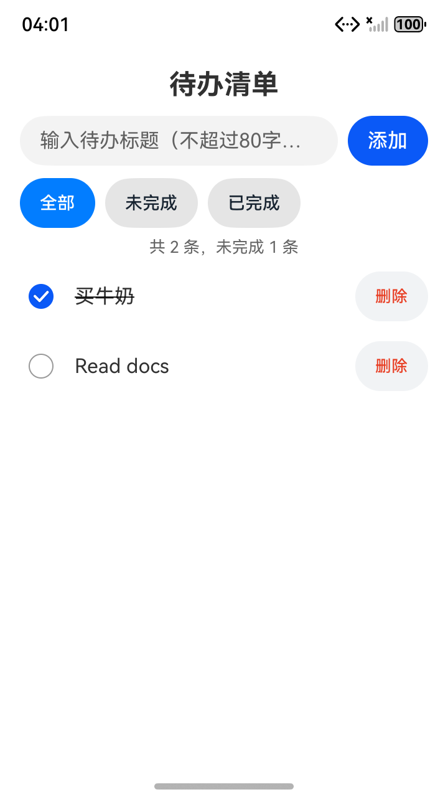

# OpenSpec + VeriKit + Runtime Corrector 鸿蒙实验（2026-10-18）

三组件已在隔离的 **OpenClaw 2026.7.1-2** 中共同运行，使用真实 **GLM-5.3-Flash** 完成从规范到 HarmonyOS API 21 TodoList 的开发与验收。首次写应用代码前，所选 Kit 文档和 OpenSpec apply 上下文均完整读回；应用纯业务 **11/11**、异常恢复 **3/3**、基础设备 **12/12**、扩展设备 **4/4**，真实保存失败提示及恢复均通过。官方 OpenSpec 最终校验为 **17/17、all_done、零问题**。

本次也记录了真实限制：RC 候选补丁校验失败；首次实现路径偏离，RC 跟进回合被取消，之后由独立反馈触发同一模型修复；上下文过大触发宿主整理。修复阶段与最终任务汇总的 RC 均为 **PASS**，见[机器摘要](evidence/20261018-triple/triple-summary.json)和[回执](evidence/20261018-triple/rc-receipts-finalize-1.json)，不覆盖历史失败。

## 安装和隔离

- 官方 **`@fission-ai/openspec@1.3.1`** 从本机已安装包完整复制到本次实验目录，包含其依赖，源码字节不变；没有更新全局安装。使用独立 XDG 配置与数据目录，并关闭遥测。
- 此版本没有 OpenClaw 专用适配器。本实验实际执行官方 `init --tools claude --profile core`，将其生成的四个原版 Skills 通过宿主 `skills.load.extraDirs` 加载；原生 `openspec_cli` 工具以固定参数执行原版 CLI。这个工具是实验接线层，不能称作官方 OpenClaw OpenSpec 插件。
- 同一宿主显式启用当前 `verikit`、`runtime-corrector` 和实验观察/CLI 接线插件。CLI 工具只允许固定变更 `persistent-todo` 的 new、status、instructions、validate 等操作，没有任意 shell 权限。
- VeriKit 基线 `c31c36a`，运行版包含此前联合实验的 RC 私有审阅会话过滤。RC 来源为只读仓库 `/Volumes/PortableSSD/projects/runtime-corrector-toy`，提交 `e136761395ef295b8218d6a3eddeb5cdb05eb610`；用其原有构建器将包写入本次隔离目录，没有修改 RC 仓库或已安装宿主。
- 工作模型和审阅模型均使用已批准的 GLM 目的地、low 档位和独立原生会话。仅发送合成需求、公开开发文档、模板和本次生成代码。密钥通过隐藏输入和子进程环境使用，不写入文件或参数。
- RC 启用需求提取、一个 OpenSpec design 产物的语义审阅与原生 Stop 纠偏；k=3。SkillCorrection、v2 artifactCorrection、implementationCorrection 关闭，不能据此声称验证了 RC 全部功能。
- 专用模拟器从全新数据目录启动，包名 `com.verikit.experiment.openspectodo`。未复制既有应用或模拟器数据；仅沿用用户已批准的输入法基本模式授权。

[安装指纹](evidence/20261018-triple/openspec-install.json)、[预先保存的实验计划](evidence/20261018-triple/triple-plan.json)、[规范进入开发前的核对](evidence/20261018-triple/spec-gate.json)。

结束后逐文件比对 OpenSpec 及依赖的 **2265 个普通文件**，全部与只读安装源一致，见[完整安装核对](evidence/20261018-triple/openspec-full-integrity.json)。本轮复制还留下一个未调用的 `.bin/yaml` 符号链接指向原安装；实际工具直接执行隔离副本的 openspec.js，YAML 库文件也在副本内。后续 setup 已改为保留原始相对链接，并在新目录实际执行 setup、官方 CLI init 和[链接核对](evidence/20261018-triple/setup-link-control.json)。该对照没有模型调用，不冒充另一次应用开发，不回写本轮记录。

## 规范与纠偏的实际结果

| 阶段 | 观察与处理 |
| --- | --- |
| 首次接线试验 | 未声明 `contracts.tools`，宿主拒绝注册 openspec_cli；该次未完成官方 CLI 流程，保留为失败。补齐实验接线清单后，在全新目录重跑。 |
| 官方 propose | 模型实际读取官方 Skill，按 CLI 依赖顺序创建 proposal、三个能力 specs、design、tasks。初始 17 项均未勾选，没有写应用代码。 |
| 自然文档审阅 | RC 提示设计需明确标题校验，模型补充。独立核对另发现错误页面路径和计数算术示例，后续模型据外部反馈修正；这两项不归功于 RC 首次检出。 |
| 受控设计冲突 | 仅向 design 追加“仅内存、重启清空、不需 Preferences/flush”，需求和正式 specs 不变。官方结构校验仍通过，真实 RC check 返回 `AGENT-GROUND-TRUTH-CONTRADICTION`。 |
| 候选补丁及修正 | RC 候选补丁 expect 与目标行不匹配，安全拒绝生成补丁。宿主模型读取诊断后删除冲突段；RC 复检及该阶段 Stop 均通过。 |
| 首次应用实现 | 业务与 SDK、基础设备通过，但 RC Stop 实际发现模型在允许路径以外创建 `store/TodoStore.ets`，判定 DEVIATION。跟进记录为 CANCELLED / RC_NATIVE_ATTEMPT_ENDED，没有自动修复。 |
| 明确反馈后修复 | 同一 GLM 把助手移入 model/、删除旧文件并更新 import；同时处理真实 SDK 的 `activeCount` 保留字段警告和独立源码审阅提出的读取失败保护。修复阶段 RC 为 PASS，历史偏离仍保留。 |
| apply 完成核对 | 外部实际验收后，模型读取冻结证据，只勾选六项外部任务。再次执行官方 validate、status、instructions apply，17/17、all_done。未执行归档。 |

受控冲突及其前后原文、哈希和两次官方校验见[控制记录](evidence/20261018-triple/controlled-design-drift.json)。RC 的真实诊断、候选补丁失败和后续复检见[机器摘要中的 artifactReviews](evidence/20261018-triple/triple-summary.json)。[首次实现的原生回执](evidence/20261018-triple/rc-receipts-develop-1.json)保留路径偏离及取消的跟进记录。

本对照明确告诉主助手正在做受控冲突检查，没有盲测，也没有证明 RC 提高了自然缺陷检出率。OpenSpec 结构有效也不能代替需求一致性审阅或应用验收。

## 写码前的读取证据

[Kit 全文审计](evidence/20261018-triple/read-before-code-proof.json)按实际原生 toolCallId、返回内容、连续范围和源文件哈希核对：

- ArkData 的 SKILL.md 和 Preferences 参考完整读回。
- ArkTS 的 SKILL.md 首次被宿主截断，模型从第 243 行续读至末尾；Promise/async-await 参考也完整读回。
- 最早应用代码 write 为 **07:52:29.302 UTC**，两套参考此前均已返回。

[OpenSpec 读取审计](evidence/20261018-triple/openspec-read-before-code-proof.json)另外确认：官方 apply Skill、status/apply instructions，以及冻结的 proposal、design、tasks、三份 specs，均在首次应用代码调用前完整返回。Markdown 规范写入没有混算为应用代码写入，后续补读也没有追记为首次通过。observer 的长文本摘要不作为全文证据，审计使用原生 transcript。

## 应用验收与真实故障

| 验收 | 实际结果 |
| --- | --- |
| 实际 TodoModel 纯逻辑 | **11/11**：空白、trim、80/81、中文、重复标题、稳定 ID、切换、筛选、删除、序列化恢复 |
| 异常存档恢复 | **3/3**：坏 JSON、非数组、非法字段条目与合法条目混合 |
| 官方 API 21 SDK | 两次实际编译均成功；修复后保留字段警告消除，仍有 getContext 弃用及可抛异常提示；unsigned HAP |
| 最终 HAP 基础设备 | **12/12**：真实安装启动、中文/英文新增、完成/恢复、统计、筛选、删除、两次进程重启 |
| 最终 HAP 扩展设备 | **4/4**：重复中文标题、纯空白、真实输入 81 字符后拒绝、连续 7 次切换后重启恢复 |
| 真实保存故障 | UI 显示“保存失败，数据可能未落盘”，内存新增仍在；撤除故障后保存队列恢复，重启恢复三个条目的 ID 与状态 |

保存故障没有替换 SDK、业务逻辑或模型回复。根据[官方 Preferences 原生备份实现](https://github.com/openharmony/distributeddatamgr_preferences/blob/master/frameworks/native/src/preferences_xml_utils.cpp)，在这个合成应用的调试沙箱里创建空的 `todoStore.bak` 目录，阻断实际备份写入路径。随后只删除该空目录，原数据文件未移动、未替换，权限仍为原来的 770/660。[实际故障与恢复](evidence/20261018-triple/device-storage-fault.json)以真实 UI 和重启结果判定，没有宣称捕获了 SDK 的具体 errno。

准备失败也保留：修改权限未生效；移动父目录被拒绝；夹具曾把错误信息中的 directory 误认为成功的 stat 结果。它们没有成功变更原应用数据，不能记为保存故障通过。最终方法使用严格类型核对和只删除空目录的恢复方式，见[准备过程](evidence/20261018-triple/storage-preparation-history.json)。扩展输入首次因原生 inputText 追加残留空格而失败，修正为实际 Ctrl+A/DEL 清空并断言后重跑，见[夹具修订](evidence/20261018-triple/input-fixture-revision.json)和[原失败](evidence/20261018-triple/device-extra-input-fixture-failure.json)。

[独立验收冻结记录](evidence/20261018-triple/independent-acceptance.json)、[SDK/源码绑定](evidence/20261018-triple/sdk-source-binding.json)、[源码归档证明](evidence/20261018-triple/application-archive-proof.json)共同核对实际源码、测试模型、HAP 和设备安装版本。构建期间没有应用代码工具写入，最终源码与 SDK 输入一致。读取失败保护仅做源码审阅；设备故障覆盖的是保存路径。

[真实保存失败截图](evidence/20261018-triple/storage-failure.png)。实际应用与完成的规范见[源码归档](../../examples/harmonyos-todolist-triple-20261018/README.md)。

## 共存影响与边界

当前 VeriKit 对 RC 私有审阅会话的过滤继续生效：已记录的私有会话没有自动 `<verikit-protocol>` 或 `<verikit-routing>` 注入，业务会话仍收到指导。OpenSpec Skills 和 CLI 均在真实宿主可见并被实际调用，原版生成 Skill 的哈希保持不变。

本次为保证四个 OpenSpec Skills 可见，将 `maxSkillsPromptChars` 设为 60000。主会话系统指导约 **7 万字符**，观察到上下文过大与自动整理；RC 产生额外真实请求和分钟级等待。因此只能确认本场景共存有效，不能称“对宿主影响很小”。没有 CPU、内存、并发负载或三组件收益的对照基准。

当前 VeriKit 回归 **16/16**，三宿主重新构建通过，见[回归日志](evidence/20261018-triple/verikit-regression.log)、[构建日志](evidence/20261018-triple/three-host-build.log)。真实开发和设备仅验证 OpenClaw/macOS；不把 MA、Windows 构建成功写成实机验证。

原始运行保留在被忽略的 `experiments/runs/20261018-triple-01`、`02`、`transport-controls` 与 `setup-link-control`；精选证据不含密钥、缓存、依赖或原始会话目录。辅助脚本在准备失败后有修订，历史以当时的实际命令、返回和报告作证，不用当前脚本哈希冒充早期版本。[保护与清理记录](evidence/20261018-triple/cleanup.json)核对 RC 原仓库、日常 profile 和全局 OpenSpec 配置未变，以及实验进程和端口退出。[复现说明](../../scripts/experiments/README.md)说明各阶段与必须保留的失败记录。

关闭模拟器时请求 SIGTERM，SDK 实际记录为 SIGABRT；记录保留该信号，并以进程和端口均退出确认清理完成，没有写成正常退出。
